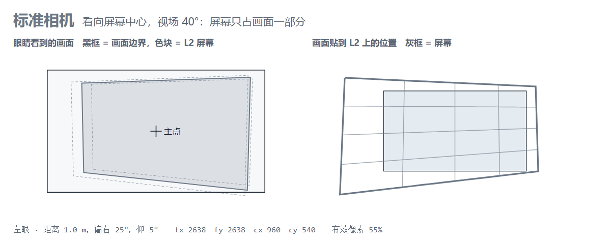
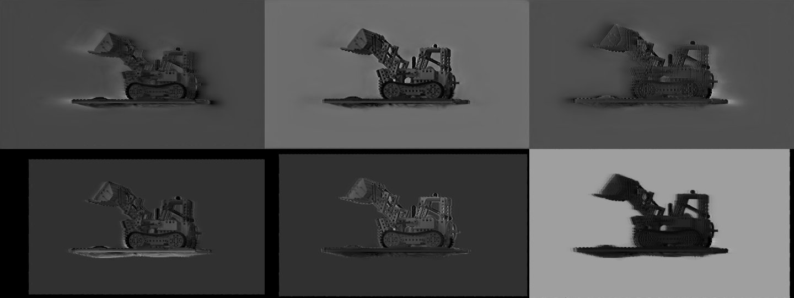

# 三层压缩光场显示：逐例物理求解、离轴相机建模与深度分层

**Compressive light field display with three stacked LCD layers: per-sample physical solving, off-axis camera modelling, and depth layering.**

这是上海创智学院金秋营实训课题"AI 驱动的压缩光场物理建模和成像分析"的个人解决方案（单人组，2026-11-06 至 11-08，共 48 小时）。

最终正式测试的四项排名分：

| 画质（50） | 速度（10） | 分层（20） | 离轴（20） |
|---|---|---|---|
| **50** | **10** | 10 | 16 |

- 正式测试共 1400 例，全流程 214 s；
- 自测双眼 PSNR：第一问 55.7 dB，离轴 55.0 dB。

**一句话**：48 小时单人完成。我负责物理建模、方向判断和评测设计，代码由 AI 编程助手（Claude Code、Codex）实现，详见[分工](#分工)。

- **物理建模**：一条视线只给出一个方程，双眼图像对应大量等价解。据此把四项评分拆成四个不同的问题，分别确定目标和测法。
- **评测设计**：用"求解相机 × 评分相机"交叉评测，揭示了自评的循环论证（自评 56.2 dB，换评分相机只有 13.5 dB），离轴从练习提交的 5 分提升到正式测试的 16–20 分。
- **瓶颈定位**：坚持按端到端分段计时，找到显存带宽和容器 CPU 配额两处瓶颈，全流程从 1168 s 降到 186 s（test3 规模），输出逐位不变。
- **复盘**：几乎每次进步都来自评测体系的改变，而不是某个方法改动。

## 问题

- **显示器**：三层 LCD，屏宽 0.596736 m，1920×1080。三层分别位于 L2 前后 6 cm（x = +0.06 / 0 / −0.06 m）。
- **成像模型**：一条视线穿过三层，三层相位相加后得到亮度，I = sin²(π/2·Σgₖ)。三层是相位叠加，没有遮挡。
- **输入与输出**：输入一对左右眼图像和两只眼的位姿，输出两套三层 RGB8 图样：
  - 第一问：在标准相机下，两只眼看到的画面要接近输入图；
  - 离轴：自己声明每只眼的离轴相机 K 和 pose，评测时复用原图。

一条视线只给出一个方程：g₁ + g₂ + g₃。两只眼的方程比三层共 3N 个未知数少得多，因此存在大量**等价解**：许多组三层图样在两只眼里看起来完全一样。四项评分于是对应四个不同的问题：

| 评分项 | 要回答的问题 | 评测怎么做 |
|---|---|---|
| 画质 | 两只眼看得对不对 | 直接比目标图 |
| 速度 | 时间花在哪 | 分段计时 |
| 离轴 | 相机怎么定义 | 独立的评分相机 |
| 分层 | 在等价解里挑哪一个 | 双眼 PSNR 不敏感，需自建分层指标 + 目视 |

## 方法

### 画质：在精确前向上逐例求解
- 网络（EyeReal 公开权重）一次前向只有约 33 dB。我把它的输出当初值，再在精确前向模型上逐例做投影 Adam（100 步，lr 0.08），按实际提交的 RGB8 量化结果选检查点。最终做到 55–57 dB。
- 渲染器在 GPU 上重写、可求导，与官方前向函数逐像素核对：最大误差 ≤ 6×10⁻⁸，有效掩码零差异。所以自测分数就是官方分数。

### 速度：拆解耗时构成，一项一项抠

第一次正式测试跑了约 16 分钟，速度只得 4 分。我没有只盯总时间，而是把耗时按阶段拆开，逐项定位瓶颈、决定优化方向；下面的融合算子和 PNG 编码由 AI 编程助手实现，每一步都核对输出与上一版逐位一致。

test3 规模（1100 例）的全流程耗时：

| 阶段 | 耗时 | 发现 |
|---|---|---|
| 原始 PyTorch 实现 | 1168 s | Adam 约占单例耗时的 60%：每步要搬运约 9 GB 数据，实际只需约 0.7 GB |
| + 融合 CUDA 算子 | 420 s | GPU 求解快了约 7 倍，端到端却只快 2.8 倍 |
| + 自定义 PNG 编码 | 约 200 s | 容器只有 20 核 CPU 配额，写 PNG 抢占了驱动 GPU 的线程 |
| + 两例在两条 CUDA 流上重叠 | 约 186 s | GPU 剩下的约 3 成空闲被填满 |

- **融合算子**（`lightfield_lab/fused.py`）：
  - 针孔眼看平面层，眼像素到层像素的映射是一个单应，两眼三层共 54 个数，坐标现算，不缓存采样网格。
  - 每步只用两个内核。K1 负责前向、残差和梯度。K2 用逆单应 gather 出双线性采样的严格转置，不用原子操作、结果确定，并在同一内核里完成 Adam 和截断。
  - 每步 3.4 → 0.43 ms。
- **PNG 编码**（`lightfield_lab/png_fast.py`）：Up 滤波 + ISA-L deflate，每张 136 → 15 ms，无损往返已验证。
- 各阶段的输出都与上一版逐位一致。

### 离轴：难点在建模，也就是怎样定义离轴观看的相机，而不在求解



- **为什么要建离轴相机**：标准相机的画框和屏幕没有关系，屏幕只占画面的一部分，斜看时还是个梯形。离轴相机要让"相机要看的画面"和"屏幕这扇窗"对齐。
- **模型**：
  - 相机中心在眼睛；
  - 成像面就是 L2 屏幕，图像像素与屏幕像素一一对应；
  - 主点是眼睛在 L2 上的垂足；
  - 焦距 = 眼到 L2 的垂距 × 每米像素数。

  写成矩阵：K = [[s·pₓ, 0, W/2 + s·p_y], [0, s·pₓ, H/2 − s·p_z], [0, 0, 1]]，s = 1920 / 0.596736 像素/米。
- **来源与我的理解**：这个相机就是 Robert Kooima 的广义透视投影（Generalized Perspective Projection），是头部跟踪显示的已有方法，最初由 AI 编程助手在复审中提出。我的贡献是想清楚它为什么成立、为什么只能这样建：
  - **Kooima 相机等价于一次透视变换**：把 L2 四角和光心（眼睛）连起来得到视锥，用垂直于原光轴（看向 O2）的平面去截，得到一个四边形；只要原光轴和屏幕法线不平行，它就是不规则的梯形。再用一个透视变换把这个四边形变成矩形，结果就和 Kooima 完全等价。
  - **所以只改 K 不够**：K 的最后一行固定为 [0, 0, 1]，放不下透视项，只能放进旋转 R。在课题的格式里，它表现为 pose 的旋转部分改变，眼睛位置不变。
  - **答案蕴含在题目条件里**：画面要对齐屏幕；用三层屏渲染后还要满足双眼视觉；测评时又复用原图。三条合在一起，只剩这一种相机。
- **交叉评测**（lego 100 对，dB）：

  | 求解 \ 评分 | 主点平移 | L2 屏幕相机 |
  |---|---|---|
  | 主点平移 | 56.24 | 13.48 |
  | L2 屏幕相机 | 14.07 | 51.62 |

  同一个求解器，相机定义对了 51.6 dB，错了只有 13.5 dB。用自己的相机求解、再用同一个相机自评，是循环论证。
- **复用原图仍然自洽**：两只眼共用同一块成像面，复用原图 51.4 dB，按该相机重新渲染 51.8 dB。
- **求解**：离轴分支用无训练的偏振场层析 SART 作初值（`lightfield_lab/tomographic.py`），再做 Adam 精修。

[交互式图解](https://yanyinnng.github.io/compressive-lightfield-3layer/)（在线打开）可以拖动眼睛位置，对比四种相机建法。

### 分层：在等价解中挑选



*lego 三层图样，从左到右依次为 L1、L2、L3。上排是原方案：三层都是整车拷贝。下排是分层版：L3 是亮背景配暗剪影，L1、L2 以物体的轮廓和细节为主。*

- **根因**：
  - 只按画质精修，一条视线上三层采样相位的梯度相同，修正被平分到三层，于是长出三份拷贝；
  - 想给某层加权补救，Adam 按像素归一化，梯度乘固定权重后更新几乎不变，加权失效。
- **方案**（`lightfield_lab/mono_depth.py`、`fused.py` 的加权模式）：
  1. 用 Depth Anything V2 Small 估相对深度；
  2. 按前、中、后景计算每个层像素对 L1/L2/L3 的归属；
  3. 加权 SART 按归属分配残差，不再平分；
  4. 再用 Adam 补回画质。
- **效果**（lego，层内亮度与归属权重的相关，0 为随机）：

  | 方案 | 层内相关 |
  |---|---|
  | 原方案 | −0.04 |
  | 提交方案（单目估深） | 约 0.14 |
  | 真值深度（上限参照） | 0.63 |

- **局限**：两只眼各自做单目估计再取平均，得到的相对深度很不可靠，也没用上双眼视差。下一步应该用双眼视差标定深度，并让分层约束贯穿整个精修。

### 评测复盘
几乎每次进步都来自评测体系的改变：
- 离轴换了评分相机，才发现自评高分靠不住；
- 速度改成端到端计时，才找到写图的瓶颈；
- 分层把三张图并排看，才发现指标涨了，三层也可能还是拷贝。

做法总结为四条：
1. 先与官方口径对齐；
2. 用好、坏两种参照校准指标；
3. 指标加目视；
4. 评测与求解解耦。

## 分工

本项目由我一人完成，使用了 AI 编程助手（Claude Code、Codex）。

- **我**：主导判断、交叉评测和几何论证。具体包括：确定各项的优化目标和验收标准；拆解问题、决定方向，在候选方案之间取舍；与助教确认题意；用官方提交做判别实验；给出离轴相机等关键环节的几何论证。
- **AI 编程助手**：完成具体实现和代码，也提出过部分方案（例如离轴的屏幕平面相机）。这些方案经我判断后决定采用或放弃。

## 仓库结构

| 路径 | 内容 |
|---|---|
| `lightfield_lab/` | 核心库 |
| `lightfield_lab/exam_geometry.py` | 与官方对齐的米制渲染器 |
| `lightfield_lab/fused.py` | 融合 CUDA 求解器（CuPy/NVRTC，或 torch 扩展） |
| `lightfield_lab/tomographic.py` | SART 层析 |
| `lightfield_lab/offaxis_models.py`、`intrinsics.py` | 离轴相机模型 |
| `lightfield_lab/mono_depth.py` | 单目深度与层归属 |
| `lightfield_lab/png_fast.py` | 快速 PNG 编码 |
| `lightfield_lab/exam_adapter.py`、`v3_submission.py` | 逐例求解流程 |
| `lightfield_lab/test_*.py` | 单元测试 |
| `solution/submit_v3.py` | 一条命令生成完整提交：两套图样、报告、代码、格式检查 |
| `solution/run_formal.sh` | 解包测试集、求解、检查 |
| `tools/` | 实验与基准脚本：离轴交叉评测、速度剖析、PNG 编码对比、焦栈与深度评测等 |
| `testing_v3/` | 课题方提供的 v3 前向参考与格式检查器（AGPL-3.0，未修改） |
| `third_party/depth_anything_v2_src/` | Depth Anything V2 源码（Apache-2.0，未修改） |
| `EyeReal/` | 上游 EyeReal（git 子模块，AGPL-3.0） |
| `docs/` | 离轴交互图解与插图 |

## 运行

```bash
git clone --recursive https://github.com/YanYinnng/compressive-lightfield-3layer.git
cd compressive-lightfield-3layer
pip install -r solution/requirements_v3.txt   # 另需 CUDA 版 PyTorch、CuPy；python-isal 可选
python tools/fetch_weights.py                 # EyeReal 预训练权重 -> weights/pretrained_model.pth
# Depth Anything V2 Small：从 Hugging Face depth-anything/Depth-Anything-V2-Small
# 下载 depth_anything_v2_vits.pth 放到 weights/

python solution/submit_v3.py --index <test_input 目录或 test.json> --out group_example
# 默认：--solver fused --layering mono --layering-eps 0.3 --lanes 2 --offaxis-model l2_camera
python testing_v3/check_submission.py --index <test.json> --submission group_example/index.json
```

- **依赖**：Python 3.10+、PyTorch（CUDA）、torchvision、NumPy、Pillow、SciPy、CuPy。没有 CuPy 时，可设置 `LF_FUSED_BACKEND=torch`，用 nvcc 编译 torch 扩展。
- **测试**：`python -m unittest discover -s lightfield_lab -p "test_*.py" -t .`
  - 共 61 项。在不含权重和课题方数据的干净克隆上，58 项通过，3 项跳过，并会打印跳过原因：

    | 跳过的测试 | 检查的内容 | 需要的外部文件 |
    |---|---|---|
    | `test_pretrained_initialization_prefers_right_eye_first` | EyeReal 网络初值按"右眼在前"的输入顺序，比反序高 2 dB 以上 | EyeReal 权重（`python tools/fetch_weights.py`）和课题方 v1.4 演示图像 |
    | `test_supplied_ply_has_complete_degree3_gaussian_fields` | 课题方 lego 3DGS 模型的字段完整（340889 个高斯、三阶球谐） | 课题方 `lego_bulldozer.ply`（84 MB） |
    | `test_supplied_poses_are_look_at_up_to_float32` | 练习集给出的位姿都精确注视屏幕中心（误差 < 0.05°），离轴模型依赖这一点 | 课题方 lego 练习集 |

  - 这三项检查的都是课题方数据或第三方权重，不是本仓库代码的功能，所以缺少这些文件时跳过不影响仓库完整性。
  - 渲染器、融合算子、离轴相机、分层等代码的正确性测试都会运行：与官方前向逐像素一致的检查使用仓库里的 `testing_v3/inference.py`；没有课题方演示数据时，改用同样几何的合成位姿和图像。

**说明**：本仓库不包含课题方的数据集、练习集和 3DGS 资产，也不包含模型权重和实验原始结果。评测平台专用的提交与调度脚本也已移除。

## 许可

- 本仓库代码以 **AGPL-3.0** 发布（见 `LICENSE`），因为它派生自 EyeReal（AGPL-3.0）。
- 第三方组件的许可见 `solution/THIRD_PARTY_NOTICES.md`。
